# AccountStore Escritorio — Informe del proyecto

**Asignatura:** Programación VI · **Evaluación:** Segundo parcial (proyecto individual)
**Estudiante:** Marcelo Benitez · **Curso/Sección:** Cuarto año, Sección B
**Fecha de presentación:** 12/11/2026

> Sistema de escritorio en **Python + Tkinter + SQLite** para gestionar la venta
> de perfiles de plataformas de streaming. Está basado en mi emprendimiento real,
> AccountStore, que hoy funciona con una planilla de Google Sheets.

---

## 1. Problema y alcance

### 1.1 Problema real, forma actual y dificultades

**AccountStore** vende perfiles de plataformas de streaming (Netflix, Disney+, HBO Max,
Crunchyroll, Paramount+, Spotify) por meses. Cada **cuenta** de una plataforma se comparte
entre varios clientes hasta un máximo de perfiles (Netflix 5, Disney+ 6, Paramount+ 4…).

**Cómo se resuelve hoy:** con una planilla de Google Sheets ("Planilla de Suscripciones").
Una hoja tiene los clientes con su fecha, meses, monto y vencimiento (calculados con fórmulas)
y hay una hoja por servicio donde se **escribe a mano el nombre del cliente** en el lugar
(perfil) que ocupa dentro de cada cuenta. Encima de la planilla hay una app web que la lee y
escribe por internet.

**Dificultades:**

1. **No hay relaciones reales:** el cliente y su lugar en la cuenta se unen solo por el
   nombre escrito en dos hojas. Si se escribe distinto ("Ana Gomez" / "Ana Gómez") se pierde
   la relación.
2. **Sobreventa:** nada impide anotar más clientes que perfiles tiene la cuenta.
3. **Datos inconsistentes:** se pueden cargar fechas o montos inválidos, clientes duplicados
   con otro teléfono, o borrar sin querer una fórmula.
4. **Lentitud y dependencia de internet:** cada consulta pasa por Google; con muchas filas la
   planilla se vuelve lenta.
5. **Permisos limitados:** quien tiene acceso a la planilla puede modificar o borrar cualquier dato.

### 1.2 Usuarios y necesidades

| Usuario | Necesidades |
|---|---|
| **Administrador** (dueño) | Ver todo; configurar servicios, cuentas y precios; crear usuarios; registrar ventas, renovaciones y bajas. |
| **Supervisor** | Atender clientes: registrar ventas, renovar, dar de baja, cargar y eliminar clientes. |
| **Pagos y vencimientos** (cobranza) | Ver qué suscripciones vencen, cobrar y registrar ventas o renovaciones, cargar clientes. **No** puede dar de baja, eliminar clientes, tocar cuentas ni crear usuarios. |
| **Cliente final** (indirecto) | Que no se le venda un perfil que no existe y que su vencimiento se calcule bien, sin perder días al renovar. |

### 1.3 Objetivo general

Desarrollar una aplicación de escritorio en Python, con interfaz Tkinter y base de datos SQLite,
que registre clientes, cuentas y suscripciones de streaming controlando automáticamente la
capacidad de perfiles de cada cuenta, los vencimientos y los pagos, con acceso por usuario y rol,
para reemplazar el control manual en planillas y evitar sobreventas y datos inconsistentes.

### 1.4 Alcance

**Módulos incluidos**

1. **Inicio y cierre de sesión** con contraseñas protegidas mediante hash y tres roles con permisos.
2. **Suscripciones (proceso principal):** tarjetas de resumen (activas, a vencer, vencidas y lo
   cobrado en el mes), nueva venta con buscador de clientes y descuento opcional (en Gs. o en %),
   renovación, baja, búsqueda, filtro por estado (ACTIVO / A VENCER / VENCIDO / BAJA) e historial
   de pagos.
3. **Clientes:** alta, edición, búsqueda y eliminación (solo si no tiene suscripciones).
4. **Cuentas y servicios:** alta y eliminación de servicios (capacidad y precio) y de cuentas, con
   la ocupación de perfiles de cada cuenta. Solo se elimina lo que no está en uso: un servicio sin
   cuentas o una cuenta sin suscripciones.
5. **Usuarios:** lista, alta y desbloqueo de usuarios (solo el Administrador).

**Funcionalidades excluidas** (no se hacen en esta versión)

- Envío de recordatorios de vencimiento por WhatsApp o SMS.
- Cambio automático de contraseñas de las cuentas de streaming.
- Importación de transferencias bancarias o pagos en línea.
- Migración automática de los datos de la planilla de Google Sheets.
- Versión móvil / web y sincronización en la nube (es una app de escritorio con base local).
- Facturación legal, reportes y gráficos.
- Recuperación automática de contraseña (por ahora se le pide al administrador por WhatsApp desde
  el inicio de sesión), cambio de contraseña y desactivación de usuarios (ver §7).

---

## 2. Diseño de la solución

### 2.1 Pantallas principales y navegación

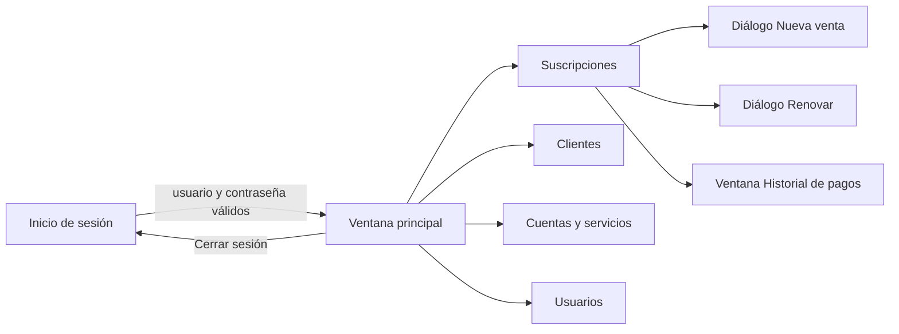

La interfaz usa la identidad visual de AccountStore PY: el logo, el amarillo de la marca
(`#EDB026`), un inicio de sesión oscuro como la pantalla de PIN de la app y tarjetas blancas sobre
fondo claro. La ventana abre maximizada y se adapta a pantallas chicas.

1. **Inicio de sesión:** fondo negro con textura y tarjeta con esquinas redondeadas, como la pantalla
   de PIN de la app. Pide usuario y contraseña, con un ojo para ver u ocultar la contraseña. Si los
   datos son incorrectos, muestra el error en rojo dentro de la tarjeta y no deja pasar. El enlace
   *"¿Olvidó su contraseña? Pídasela al administrador"* abre WhatsApp con el administrador y deja el
   mensaje ya escrito, igual que *"Pedíselo al administrador"* en la app. Tras 3 contraseñas
   incorrectas seguidas, el usuario queda bloqueado 5 minutos (RN10).

   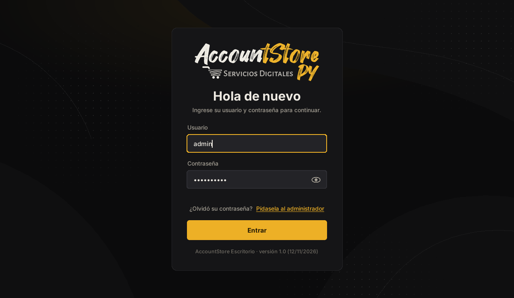

   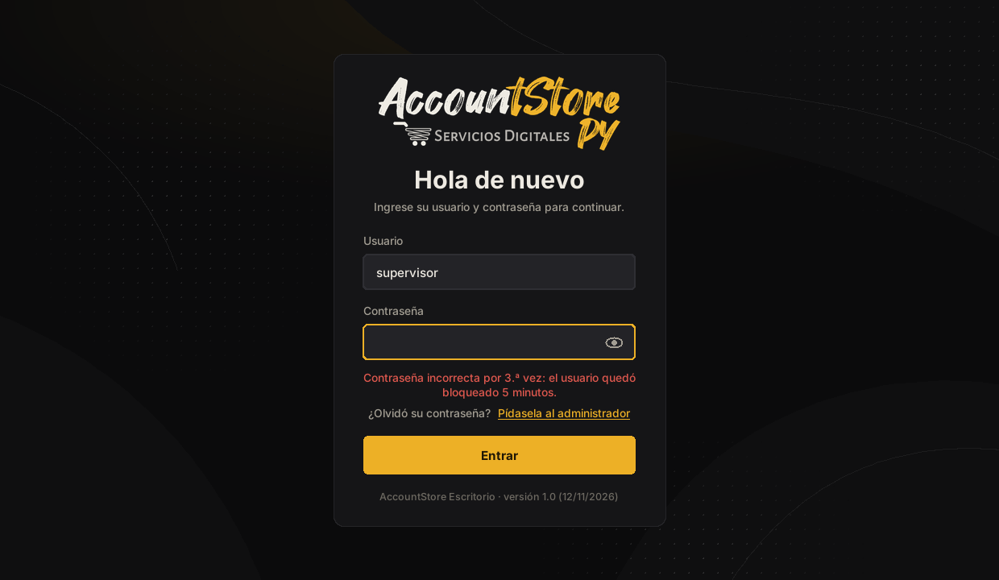

2. **Ventana principal:** a la izquierda, un menú lateral con el logo, las secciones, el usuario con
   su rol y el botón *Cerrar sesión*, que vuelve al inicio de sesión. Cada vez que se abre una sección
   se vuelven a leer sus datos de la base.
3. **Suscripciones:** tarjetas de resumen, filtros por estado con la cantidad de cada uno, buscador
   y lista coloreada por estado. Botones *Nueva venta*, *Renovar*, *Historial de pagos* (también con
   doble clic) y *Dar de baja*.

   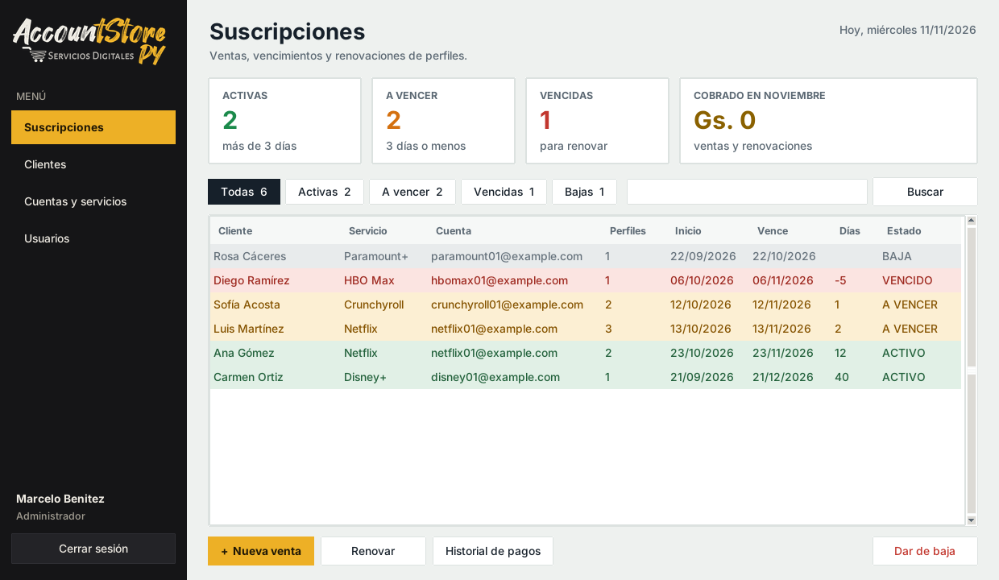

4. **Nueva venta:** el cliente se busca escribiendo parte del nombre o del teléfono, y la lista se
   filtra mientras se escribe (encuentra "gomez" aunque el nombre sea "Gómez"). Después se eligen el
   servicio y la cuenta (muestra los perfiles libres), los perfiles, los meses, la fecha y, si hace
   falta, un descuento en Gs. o en %. Antes de guardar se muestran el vencimiento, el subtotal, el
   descuento y el total a cobrar.

   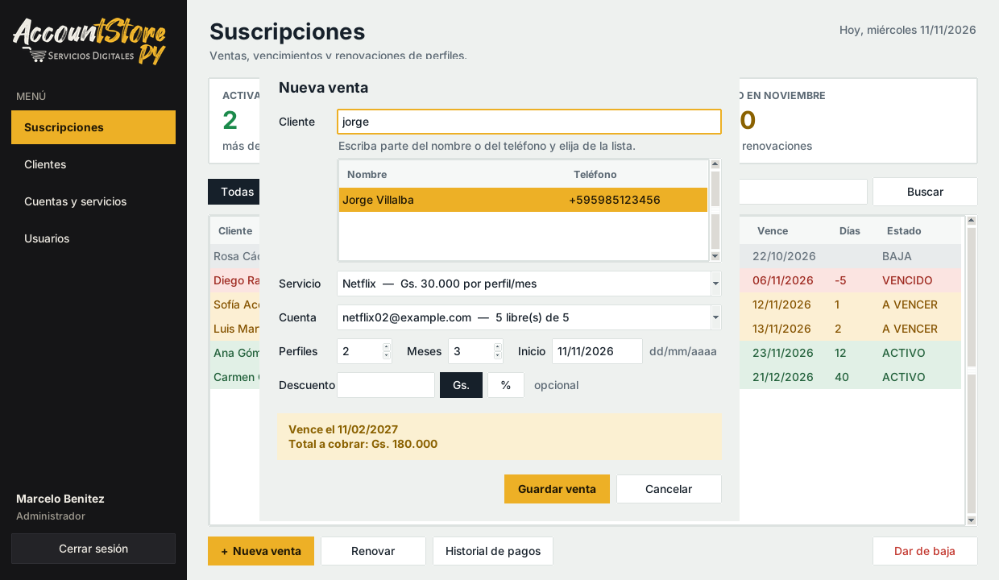

   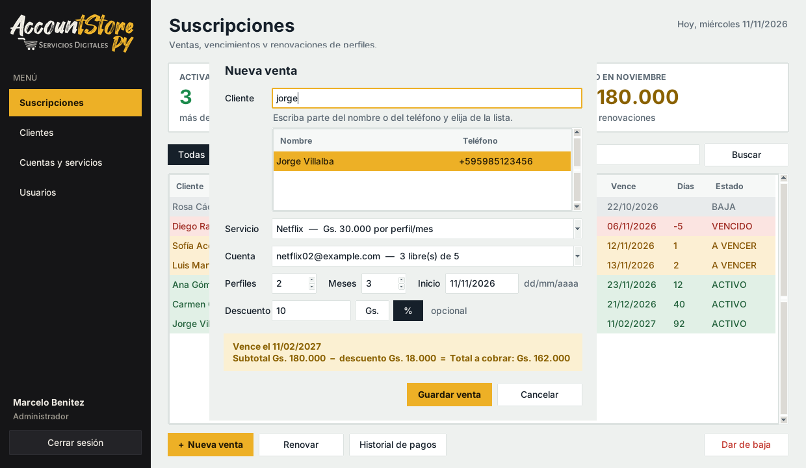

5. **Clientes:** formulario de alta a la izquierda y lista con buscador a la derecha. Con *Editar
   cliente seleccionado* (o doble clic en la fila), los datos del cliente pasan al formulario, que
   cambia a *Editar cliente*; se corrigen y se guardan con las mismas validaciones que al crearlo.

   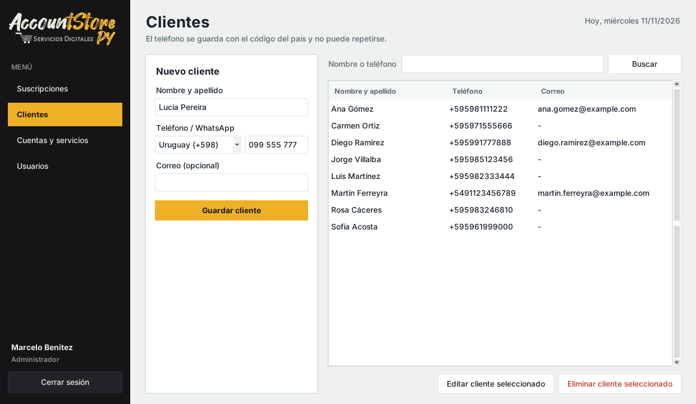

   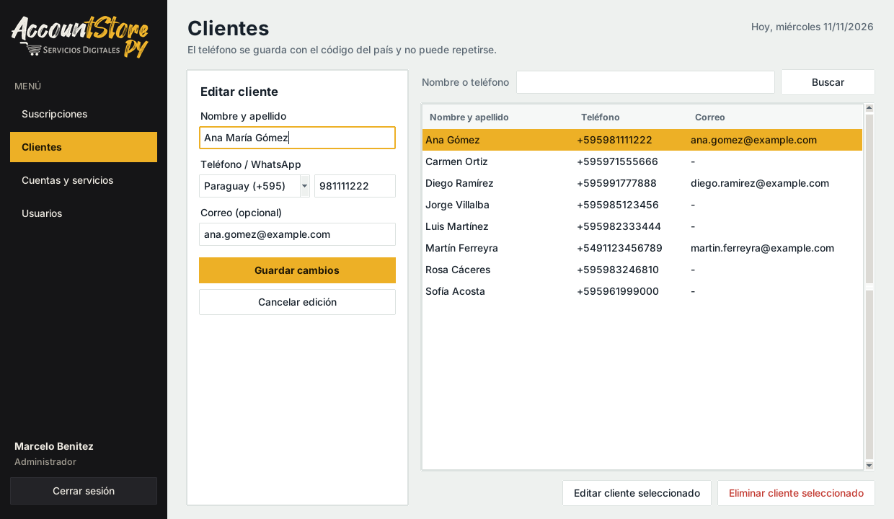

6. **Cuentas y servicios:** servicios con capacidad y precio; cuentas con perfiles ocupados y libres
   (en rojo las cuentas llenas).

   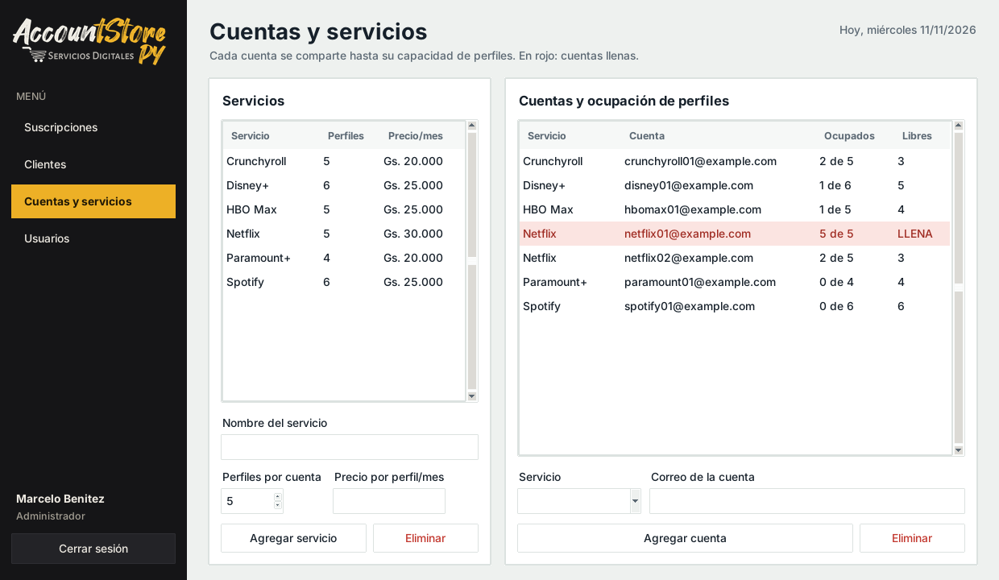

7. **Usuarios:** lista de usuarios con su estado (Activo o Bloqueado), formulario de alta y botón
   *Desbloquear usuario seleccionado* (solo Administrador).

   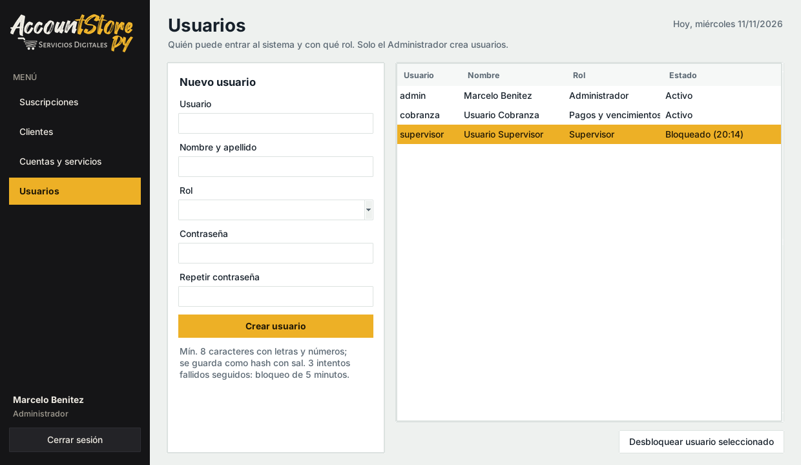

### 2.2 Modelo de datos

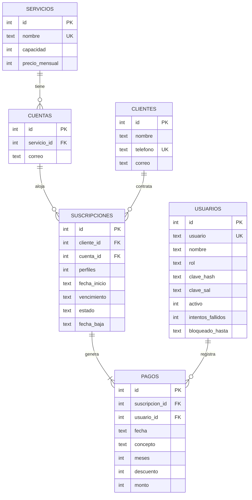

| Relación | Tipo | Significado |
|---|---|---|
| servicios → cuentas | 1 a N | Netflix tiene varias cuentas (netflix01, netflix02…). |
| cuentas → suscripciones | 1 a N | Una cuenta se comparte entre varios clientes hasta su capacidad. |
| clientes → suscripciones | 1 a N | Un cliente puede tener varios servicios. |
| suscripciones → pagos | 1 a N | La venta genera un pago y cada renovación genera otro. |
| usuarios → pagos | 1 a N | Queda registrado qué usuario cobró cada pago. |

El esquema completo está en [`datos/esquema.sql`](../datos/esquema.sql).

### 2.3 Reglas de negocio propias del proyecto

| # | Regla | Dónde está |
|---|---|---|
| **RN1** | **Capacidad de la cuenta:** no se pueden vender más perfiles que los libres de la cuenta (Netflix 5, Disney+ 6…). Los perfiles ocupados son la suma de las suscripciones **ACTIVAS** de esa cuenta. | `logica/reglas.py → validar_cupo` |
| RN2 | **Vencimiento** = fecha de inicio + meses pagados, como `FECHA.MES` de la planilla: 31/01 + 1 mes = 28/02. | `reglas.sumar_meses` |
| RN3 | **Estado por días** (igual que en la planilla): más de 3 días → ACTIVO; de 1 a 3 → A VENCER; 0 o menos → VENCIDO. | `reglas.estado_por_dias` |
| RN4 | **Monto** = precio mensual × perfiles × meses − descuento. Una venta o renovación es de 1 a 12 meses. | `reglas.calcular_monto` |
| RN5 | **Renovación sin perder días:** si todavía no venció, se renueva desde el vencimiento; si ya venció, desde hoy. | `reglas.inicio_renovacion` |
| RN6 | **Los perfiles solo se liberan con la baja:** una suscripción vencida sigue ocupando su lugar hasta que alguien con permiso la da de baja. | consulta de `repositorio.listar_cuentas` |
| RN7 | **Permisos por rol:** "Pagos y vencimientos" no puede dar de baja, eliminar clientes, tocar cuentas ni crear usuarios. | `logica/permisos.py` |
| RN8 | **Un teléfono = un cliente, con código de país:** se elige el país (Paraguay por defecto, igual que en la app de ventas) y el número se guarda en formato internacional: `0981 123 456` → `+595981123456`; un número de Uruguay `099 555 777` → `+59899555777`. Así sirve para WhatsApp, se aceptan clientes extranjeros y el mismo número no puede repetirse aunque se escriba distinto. | `reglas.normalizar_telefono` + `UNIQUE` |
| RN9 | **Descuento:** en una venta o renovación se puede descontar un monto en Gs. o un porcentaje, como en la app de ventas. No puede ser negativo, el porcentaje no pasa de 100 % y el total a cobrar tiene que quedar mayor a cero. Se guarda en el pago cuánto se descontó. | `reglas.calcular_descuento` |
| RN10 | **Bloqueo por intentos fallidos:** 3 contraseñas incorrectas seguidas bloquean al usuario 5 minutos (aunque luego escriba la correcta). Se guarda en la base; entrar bien reinicia el contador; el Administrador puede desbloquear. | `gestor.iniciar_sesion` |

---

## 3. Proceso principal del demo: venta de perfiles

**Secuencia completa desde Tkinter** (paso a paso en [GUION_DEMO.md](GUION_DEMO.md)):

1. Inicio sesión → sección **Suscripciones** → **Nueva venta**.
2. Elijo cliente, servicio y cuenta, y cargo perfiles, meses y fecha. El sistema calcula
   vencimiento (RN2) y monto (RN4).
3. **Guardar venta:** la lógica valida los datos, controla la capacidad (RN1) y guarda la
   suscripción y su pago en **una sola transacción**.
4. El sistema confirma la venta, que aparece seleccionada en la lista **leída de nuevo desde la base**.
   También se ve en *Historial de pagos* y en *Cuentas y servicios* (bajan los perfiles libres).

| Venta guardada | Recuperada en la lista |
|---|---|
| 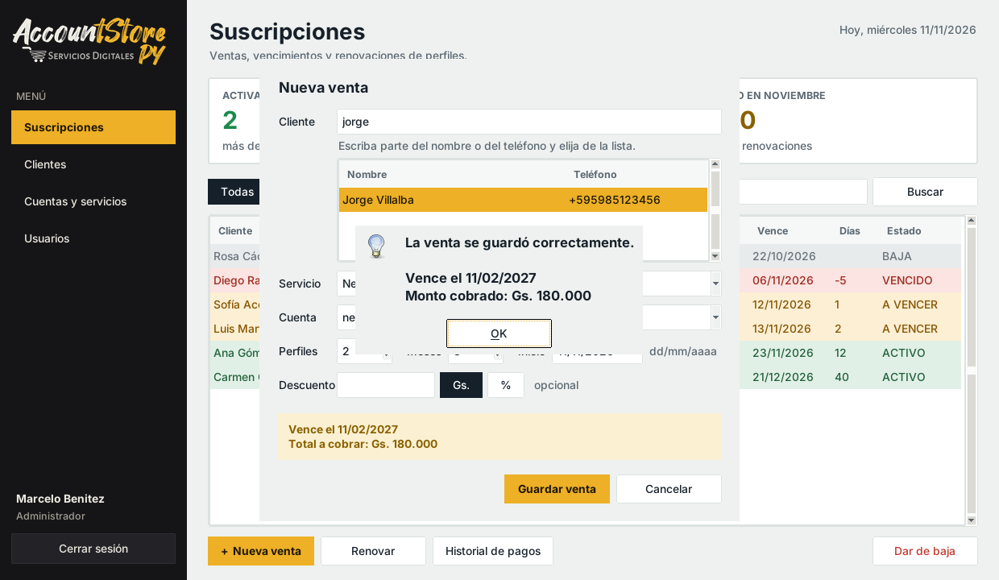 | 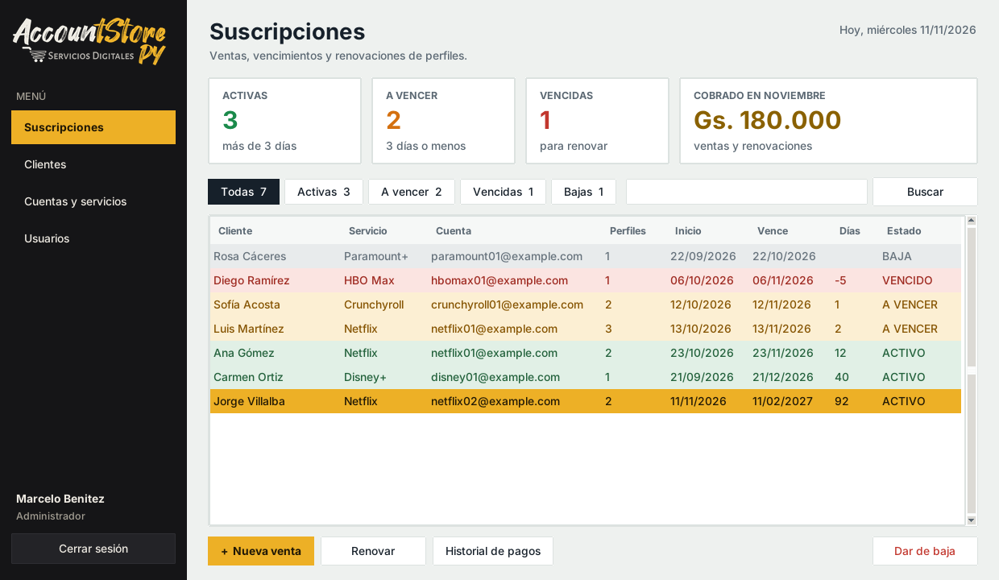 |

**Datos inválidos rechazados sin guardar nada:**

| Cuenta llena (regla RN1) | Meses fuera de rango |
|---|---|
| 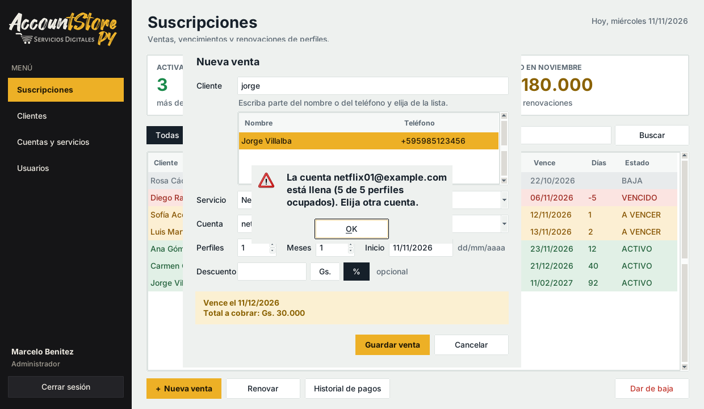 | 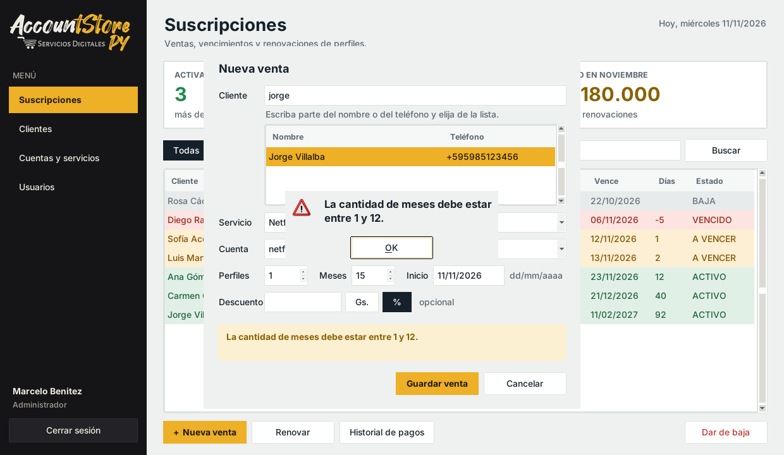 |

En todos los casos el formulario queda abierto para corregir, conserva lo escrito y **no se escribe
nada** en la base, porque la validación ocurre **antes** del `INSERT`. La base es la última barrera
(§4.2).

**Validaciones de cada campo** (`logica/reglas.py`):

| Campo | Se acepta | Se rechaza (ejemplos) |
|---|---|---|
| Nombre de persona (cliente, usuario) | Letras con tildes y ñ, espacios, `'` `.` `-`; al menos 3 letras; hasta 60 caracteres | `123`, `!!!`, `Ana 2`, `Al`, vacío |
| Teléfono | Celular del país elegido; se guarda como `+595981123456` | `abc`, `0981`, `021 123 456` (fijo), número de otro país, repetido |
| Correo | `nombre@dominio.com` (también `.com.py`, `+`, `.`); opcional en clientes | `sinarroba`, `ana@`, `ana@gmail`, `ana@@gmail.com`, `ana@gmail..com` |
| Usuario | Empieza con letra; 3 a 20 letras sin tilde, números, `.` o `_` | `123`, `...`, `ab`, `con espacio`, repetido (sin importar mayúsculas) |
| Contraseña | 8 a 64 caracteres con letras y números; las dos iguales | `corta1`, `solamenteletras`, `12345678`, distintas |
| Servicio | Letras y números, `+ . & -` (`Disney+`, `Office 365`); hasta 30; no repetido | `123`, `!!!`, `NETFLIX` si existe `Netflix` |
| Capacidad / precio | 1 a 20 perfiles; Gs. 1.000 a 10.000.000 (acepta `30.000`) | `0`, `abc`, `-3`, `500`, `30,000` |
| Perfiles | Entero ≥ 1 y que entre en los libres de la cuenta | `0`, `abc`, `1.5`, más que los libres |
| Meses | Entero de 1 a 12 | `0`, `13`, `uno` |
| Fecha de inicio | `dd/mm/aaaa` existente, no futura, de hasta un año atrás | `31/02/2026`, `2026-11-12`, mañana, `01/01/1900` |
| Descuento | Vacío, Gs. o % entero; total final mayor a cero | `-5`, `abc`, `10.5 %`, `101 %`, igual o mayor al total |

En las pruebas automáticas y en un recorrido de la interfaz se intentaron **121 datos inválidos**
en la lógica y **49 casos** en los formularios. Todos fueron rechazados con un mensaje claro, sin
guardar nada y sin cerrar el programa.

---

## 4. Base de datos

### 4.1 Claves primarias y foráneas

- **Clave primaria (PK):** cada tabla tiene `id INTEGER PRIMARY KEY AUTOINCREMENT`. Identifica cada
  fila de forma única y SQLite la genera solo.
- **Claves foráneas (FK):**

| Tabla.columna | Referencia a | Para qué |
|---|---|---|
| `cuentas.servicio_id` | `servicios.id` | Cada cuenta pertenece a un servicio existente. |
| `suscripciones.cliente_id` | `clientes.id` | No puede haber suscripción de un cliente inexistente. |
| `suscripciones.cuenta_id` | `cuentas.id` | Ni de una cuenta inexistente. |
| `pagos.suscripcion_id` | `suscripciones.id` | Cada pago pertenece a una suscripción. |
| `pagos.usuario_id` | `usuarios.id` | Se sabe quién registró el cobro. |

Todas usan `ON DELETE RESTRICT`: **no se puede borrar un registro que otro usa**. Por ejemplo, no se
puede eliminar un cliente que tiene suscripciones.

> ⚠️ En SQLite las FK vienen **desactivadas**. Por eso `datos/conexion.py` ejecuta
> `PRAGMA foreign_keys = ON` cada vez que abre la conexión.

### 4.2 Restricciones que evitan datos inconsistentes

| Restricción | Ejemplo | Qué evita |
|---|---|---|
| `NOT NULL` | `clientes.telefono` | Registros incompletos. |
| `UNIQUE` | `clientes.telefono`, `usuarios.usuario`, `servicios.nombre` (con `COLLATE NOCASE`: "netflix" y "Netflix" son el mismo), `(servicio_id, correo)` en cuentas | Duplicados. |
| `CHECK` | `perfiles >= 1`, `capacidad > 0`, `monto > 0`, `meses BETWEEN 1 AND 12`, `vencimiento > fecha_inicio`, `rol IN (…)`, `estado IN ('ACTIVA','BAJA')`, `telefono GLOB '+[0-9]*'` (formato internacional), `descuento >= 0` | Valores imposibles. |
| `FOREIGN KEY … RESTRICT` | ver 4.1 | Referencias a registros inexistentes y borrados que dejan "huérfanos". |

**Demostración:**
- **Desde la interfaz:** eliminar a *Ana Gómez* (tiene suscripciones) o cargar un cliente con el
  teléfono `0981 111 222` (ya existe). Los dos casos se rechazan con un mensaje claro.

  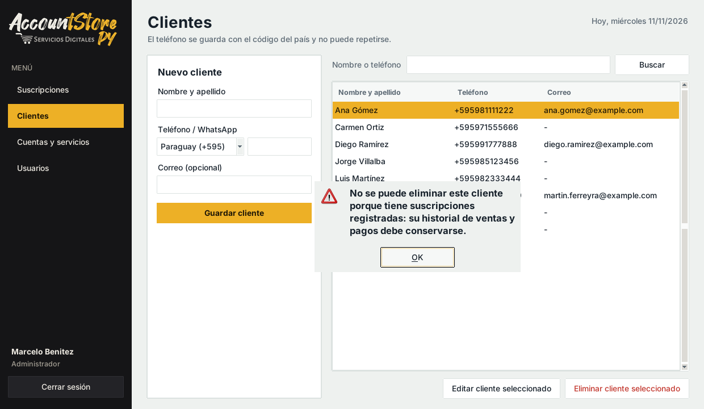

- **Directamente en la base, sin pasar por la app:** `python demo_restricciones.py` intenta 8
  operaciones inválidas con SQL y SQLite las rechaza todas:

```
[RECHAZADO] Suscripción de un cliente que no existe (clave foránea)
            SQLite: FOREIGN KEY constraint failed
[RECHAZADO] Suscripción con 0 perfiles (CHECK perfiles >= 1)
            SQLite: CHECK constraint failed: perfiles >= 1
[RECHAZADO] Vencimiento anterior al inicio (CHECK vencimiento > fecha_inicio)
[RECHAZADO] Cliente con un teléfono que ya existe (UNIQUE)
            SQLite: UNIQUE constraint failed: clientes.telefono
[RECHAZADO] Teléfono sin el código de país (CHECK telefono GLOB '+[0-9]*')
[RECHAZADO] Pago con monto negativo (CHECK monto > 0)
[RECHAZADO] Usuario con un rol inexistente (CHECK rol IN ...)
[RECHAZADO] Eliminar un cliente que tiene suscripciones (ON DELETE RESTRICT)
            SQLite: FOREIGN KEY constraint failed
```

### 4.3 Persistencia (cerrar y volver a abrir)

La base es el archivo `accountstore.db`, que queda en el disco. Cada operación termina con `COMMIT`
(lo hace `with self.conexion:`). Para demostrarlo: registro una venta, cierro el programa, lo abro de
nuevo, inicio sesión y la venta sigue en la lista. También se puede ver con `python inspeccionar_bd.py`.
La prueba automática `test_los_datos_permanecen_al_cerrar_y_abrir` lo comprueba.

### 4.4 Consultas del demo

**Inserción** (`datos/repositorio.py → insertar_venta`):

```python
sql_suscripcion = """INSERT INTO suscripciones
                         (cliente_id, cuenta_id, perfiles, fecha_inicio, vencimiento)
                     VALUES (?, ?, ?, ?, ?)"""
sql_pago = """INSERT INTO pagos (suscripcion_id, usuario_id, fecha, concepto, meses,
                                 descuento, monto)
              VALUES (?, ?, ?, 'VENTA', ?, ?, ?)"""
with self.conexion:                                   # transacción
    cursor = self.conexion.execute(sql_suscripcion, (cliente_id, cuenta_id, perfiles,
                                                     fecha_inicio, vencimiento))
    suscripcion_id = cursor.lastrowid                 # id que SQLite asignó
    self.conexion.execute(sql_pago, (suscripcion_id, usuario_id, fecha_inicio, meses,
                                     descuento, monto))
```

- Cada `?` es un **parámetro**: el valor viaja aparte y nunca se mezcla con el texto SQL.
- `cursor.lastrowid` devuelve el `id` de la suscripción recién creada, que se usa como FK del pago.
- En el pago se guarda el descuento aplicado y el monto cobrado (ya con el descuento).
- `with self.conexion:` hace que las dos inserciones sean **una transacción**: si falla la segunda,
  se deshace la primera (`ROLLBACK`). No puede quedar una venta sin su pago.

**Recuperación** (`repositorio.listar_suscripciones`):

```sql
SELECT su.id, cl.nombre AS cliente, cl.telefono, se.nombre AS servicio,
       cu.correo AS cuenta, su.perfiles, su.fecha_inicio, su.vencimiento, su.estado
FROM suscripciones su
JOIN clientes  cl ON cl.id = su.cliente_id      -- FK -> nombre y teléfono del cliente
JOIN cuentas   cu ON cu.id = su.cuenta_id       -- FK -> correo de la cuenta
JOIN servicios se ON se.id = cu.servicio_id     -- FK -> nombre del servicio
WHERE sin_tildes(cl.nombre) LIKE sin_tildes(?) OR cl.telefono LIKE ?
      OR se.nombre LIKE ?
ORDER BY su.vencimiento
```

- Los `JOIN` usan las claves foráneas para traer datos de las 4 tablas en una sola consulta.
- `LIKE ?` con `%texto%` permite el buscador (parametrizado). `sin_tildes` es una función propia
  registrada en SQLite (`datos/conexion.py`): compara sin tildes ni mayúsculas, así "ramirez"
  encuentra "Ramírez".
- `ORDER BY su.vencimiento` muestra primero lo que vence antes.
- Los días restantes y el estado (ACTIVO / A VENCER / VENCIDO) **no se guardan**: los calcula la
  lógica con la fecha de hoy (RN3), así nunca quedan desactualizados.

---

## 5. Código y seguridad inicial

### 5.1 Organización en capas

```
accountstore_escritorio/
├── main.py                 # arranque: conecta la base, crea el gestor y abre la ventana
├── interfaz/               # CAPA DE INTERFAZ (Tkinter): solo muestra y llama a la lógica
│   ├── app.py              #   navegación entre login y ventana principal
│   ├── login.py, principal.py, suscripciones.py, clientes.py, cuentas.py, usuarios.py
│   ├── comun.py            #   colores de la marca, estilos, tablas y manejo seguro de errores
│   ├── widgets.py          #   campos y botones redondeados y fondo con textura (Canvas)
│   └── recursos/           #   logo e ícono de AccountStore PY
├── logica/                 # CAPA DE LÓGICA: reglas, validaciones, permisos y seguridad
│   ├── gestor.py           #   operaciones del sistema (vender, renovar, dar de baja…)
│   ├── reglas.py           #   reglas de negocio y validaciones (funciones puras)
│   ├── permisos.py         #   roles y permisos
│   ├── seguridad.py        #   hash de contraseñas
│   └── errores.py, datos_ejemplo.py
├── datos/                  # CAPA DE ACCESO A DATOS: el único lugar con SQL
│   ├── conexion.py, esquema.sql, repositorio.py
└── pruebas/                # pruebas automáticas (unittest)
```

Regla de dependencias: **interfaz → lógica → datos**. La interfaz no tiene SQL ni importa `sqlite3`,
y la capa de datos no conoce Tkinter.

### 5.2 Inicio/cierre de sesión y contraseñas con hash

- Las contraseñas se guardan con **PBKDF2-HMAC-SHA256**, una **sal aleatoria de 16 bytes** por usuario
  y **600 000 iteraciones** (valor recomendado por OWASP). Ver `logica/seguridad.py`.
- Al iniciar sesión se calcula el hash de lo que escribió el usuario con su misma sal, y se compara con
  `hmac.compare_digest`.
- Si el usuario no existe o la clave es incorrecta, el mensaje es el mismo: *"Usuario o contraseña
  incorrectos"* (no revela qué usuarios existen).
- **Bloqueo por intentos fallidos:** tras 3 contraseñas incorrectas seguidas, el usuario queda
  bloqueado 5 minutos, aunque después escriba la contraseña correcta. Los intentos y la hora de fin
  del bloqueo se guardan en la tabla `usuarios`, así que cerrar y abrir el programa no lo evita. Al
  entrar bien, el contador vuelve a cero. El Administrador puede desbloquearlo antes desde *Usuarios*.
- *Cerrar sesión* borra el usuario actual (`gestor.usuario = None`) y vuelve al login. Sin sesión,
  la lógica rechaza cualquier operación.
- `python inspeccionar_bd.py usuarios` muestra que en la base solo están el hash y la sal:

```
id | usuario | nombre | rol | clave_hash | clave_sal | activo
1 | admin | Marcelo Benitez | ADMIN | 250de84f35a6bf2c098e…58082cc | 5924ef10d116…cabf54 | 1
```

### 5.3 Permisos por rol

| Acción | Administrador | Supervisor | Pagos y vencimientos |
|---|:-:|:-:|:-:|
| Registrar venta / renovar | ✔ | ✔ | ✔ |
| Registrar y editar clientes | ✔ | ✔ | ✔ |
| Dar de baja | ✔ | ✔ | ✘ |
| Eliminar clientes | ✔ | ✔ | ✘ |
| Agregar servicios y cuentas | ✔ | ✔ | ✘ |
| Crear y desbloquear usuarios | ✔ | ✘ | ✘ |

El control está en la **lógica** (`exigir_permiso` al comienzo de cada operación de `gestor.py`), no
en la interfaz: el botón *Dar de baja* está a la vista para todos, pero la lógica rechaza la acción.

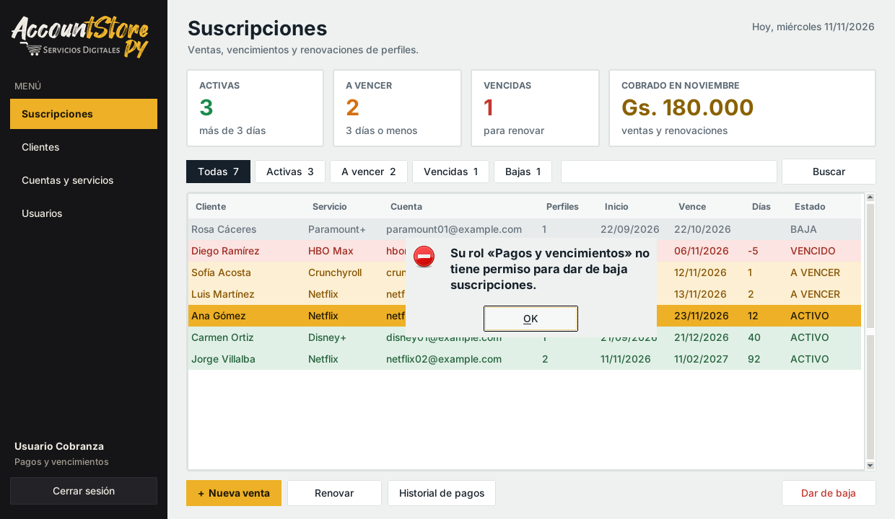

### 5.4 Consultas parametrizadas y manejo de errores

- **Todas** las consultas usan `?`. Nunca se arma SQL concatenando lo que escribe el usuario:

```python
# MAL (inyección SQL): f"SELECT * FROM usuarios WHERE usuario = '{usuario}'"
# BIEN:
self.conexion.execute("SELECT ... FROM usuarios WHERE usuario = ?", (usuario,))
```

- **Errores esperados:** la lógica lanza `ErrorValidacion` o `PermisoDenegado` con un mensaje claro.
  Los errores técnicos de SQLite (`IntegrityError`) se traducen a mensajes entendibles en `gestor.py`.
- **Errores inesperados:** `interfaz/comun.py → ejecutar_seguro` envuelve cada acción en
  `try/except`, muestra un aviso y guarda el detalle en `errores.log`. Además,
  `report_callback_exception` (en `app.py`) captura cualquier error de un botón. **El programa
  nunca se cierra por un error.**
- **Base de una versión anterior:** el esquema lleva un número de versión (`PRAGMA user_version`).
  Si `accountstore.db` es de una versión vieja, al abrir el programa se avisa que hay que borrarla,
  en lugar de fallar después en medio de una venta.

---

## 6. Uso de IA

> ✏️ **Completar con mis propias palabras antes de presentar.**

**Ejemplo de uso:** usé un asistente de IA (Claude) para analizar la rúbrica y proponer cómo adaptar
mi sistema real (AccountStore, hecho en Google Apps Script con Google Sheets) a una aplicación
de escritorio en Python con Tkinter y SQLite. También lo usé para generar una primera versión del
código en capas y de este informe.

**Cómo verifiqué el resultado:**

1. Ejecuté las **66 pruebas automáticas** (`python -m unittest -v`) y todas pasaron. Las pruebas
   comprueban las reglas de negocio (fin de mes, estados, capacidad), los permisos, las
   restricciones de la base y la persistencia.
2. Comparé las reglas con mi sistema real: el estado por días (> 3 ACTIVO, 1 a 3 A VENCER,
   ≤ 0 VENCIDO), las capacidades (Netflix 5, Disney+ 6, Paramount+ 4) y los roles.
3. Probé a mano cada paso del guion del demo, incluidos los casos inválidos.
4. Revisé con `inspeccionar_bd.py` que las contraseñas no estén en texto plano.
5. **Corrección o ajuste que hice yo:** _(completar con un ejemplo real. Por ejemplo: cambié un
   precio, un mensaje o una validación porque no coincidía con cómo trabaja mi negocio, y volví a
   correr las pruebas)._

---

## 7. Presentación y planificación

### 7.1 Estado de las funcionalidades

| Estado | Funcionalidad |
|---|---|
| ✅ **Terminado** | Inicio y cierre de sesión con hash; roles y permisos. |
| ✅ **Terminado** | Venta con control de capacidad, vencimiento y monto; transacción suscripción + pago. |
| ✅ **Terminado** | Renovación sin pérdida de días; baja que libera perfiles; historial de pagos. |
| ✅ **Terminado** | Lista de suscripciones con estados por color, buscador, filtros y tarjetas de resumen (incluye lo cobrado en el mes). |
| ✅ **Terminado** | Interfaz con la identidad de AccountStore PY (logo, colores, menú lateral), adaptable a pantallas chicas. |
| ✅ **Terminado** | Alta de clientes, servicios, cuentas y usuarios; ocupación de cuentas; eliminación de servicios y cuentas que no están en uso. |
| ✅ **Terminado** | Clientes de otros países: selector de país y teléfono guardado con código internacional. |
| ✅ **Terminado** | Descuento en ventas y renovaciones (en Gs. o en %) y buscador de clientes sin tildes en la venta. |
| ✅ **Terminado** | Edición de clientes y bloqueo de 5 minutos tras 3 contraseñas incorrectas, con desbloqueo por el Administrador. |
| ✅ **Terminado** | Restricciones de base (PK, FK, UNIQUE, CHECK) y 66 pruebas automáticas. |
| 🟡 **Parcial** | Usuarios: se crean, pero **no se pueden desactivar ni cambiar su contraseña** desde la interfaz (la columna `activo` ya existe y el login la respeta). |
| ⏳ **Pendiente** | Importar clientes y suscripciones desde la planilla actual (CSV). |
| ⏳ **Pendiente** | Recordatorio de vencimiento por WhatsApp (enlace `wa.me` con mensaje). |
| ⏳ **Pendiente** | Reporte de cobros por mes y por usuario. |

### 7.2 Prioridades y plazos

| Prioridad | Tarea | Plazo |
|:-:|---|---|
| 1 | Cambiar contraseña y desactivar usuarios desde *Usuarios* | 13/11 – 19/11/2026 |
| 2 | Importación desde CSV de la planilla actual | 20/11 – 30/11/2026 |
| 3 | Reporte de cobros por mes y por usuario | 01/12 – 07/12/2026 |
| 4 | Recordatorio de vencimiento por WhatsApp | 08/12 – 14/12/2026 |

Las prioridades siguen este criterio: primero lo que completa los módulos ya existentes, después la
seguridad y por último lo que ahorra trabajo manual en el negocio.
